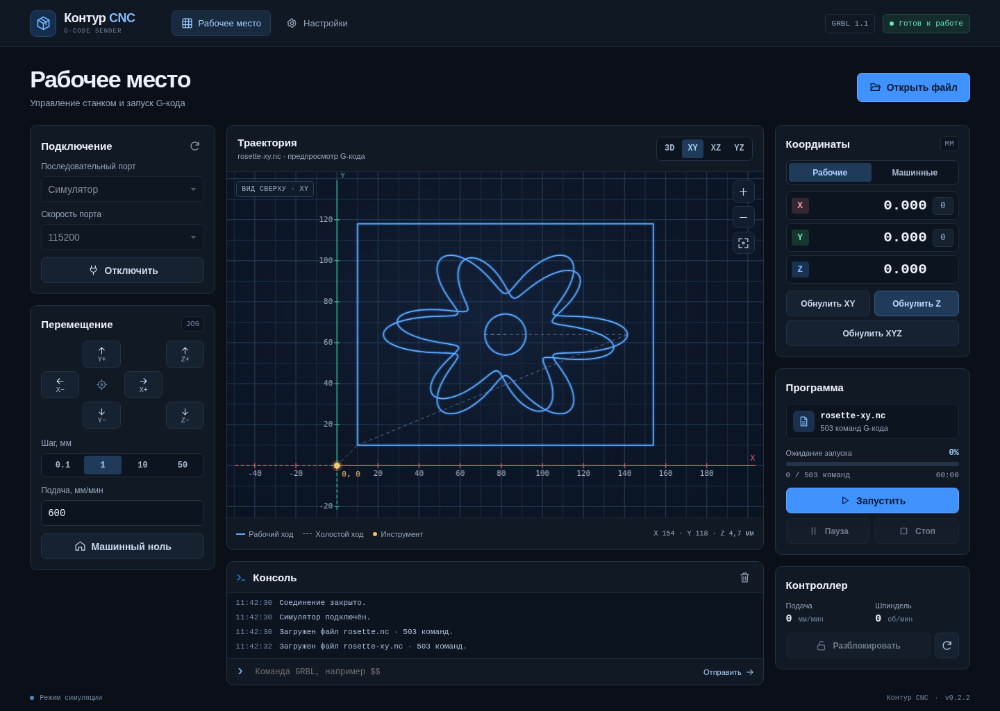
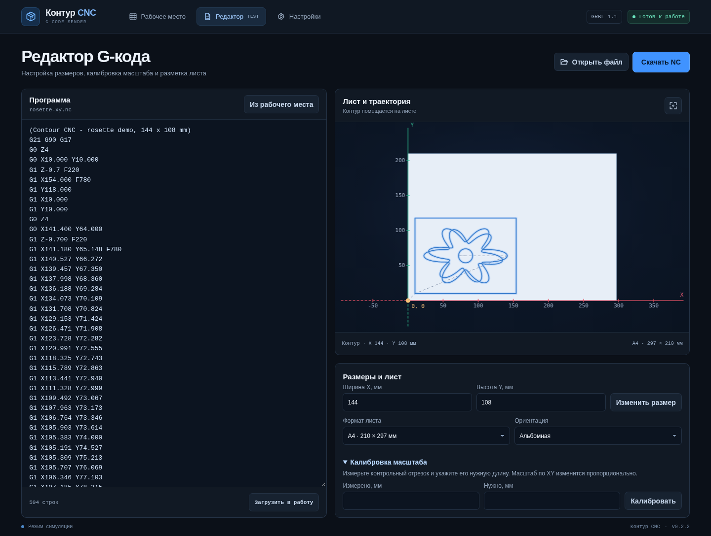

# Контур CNC

**Локальный отправитель и редактор G-кода для GRBL 1.1.** Русский интерфейс, предпросмотр траектории и симулятор для знакомства с программой без станка.

[Скачать Windows x64](https://github.com/san5ezez/countour-cnc/releases/latest) · [Запуск из исходников](#запуск-из-исходников) · [Редактор G-кода](#редактор-g-кода)



## Быстрый старт

1. Откройте [последний релиз](https://github.com/san5ezez/countour-cnc/releases/latest) и скачайте `Contour-CNC-x64.exe`.
2. Запустите файл двойным щелчком на Windows 10 или 11 x64. Python и библиотека для COM-портов уже включены. Панель откроется в браузере по умолчанию, её адрес также указан в консольном окне.
3. Нажмите **Запустить**, чтобы проверить пример в симуляторе. Свой NC-файл можно открыть кнопкой или перетащить на поле траектории.

## Рабочее место

| Возможность | Что доступно |
| --- | --- |
| Управление осями | Короткое нажатие перемещает на выбранный шаг. Удержание стрелки двигает ось до отпускания. |
| Нули | Обнуление рабочих XY, Z и XYZ, кнопки для отдельных X и Y и цикл поиска машинного нуля. |
| Предпросмотр | Вид сверху XY с осями и шкалой в миллиметрах, изометрия, XZ и YZ, масштаб и панорамирование. |
| Программа | Запуск, пауза, коррекция подачи на паузе, продолжение, остановка, прогресс и консоль GRBL. |
| Настройки | Набор шагов, подача, скорость порта, точность координат, начальный вид, сетка и клавиатура. Параметры сохраняются в браузере. |

## Редактор G-кода

Для запуска двойным щелчком скачайте сборку **Contour-CNC-TEST** из [последнего релиза](https://github.com/san5ezez/countour-cnc/releases/latest). Обычный EXE поддерживает тот же режим через параметр `--test`. В PowerShell из папки с EXE выполните:

```powershell
.\Contour-CNC-x64.exe --test
```

Редактор откроется сразу. Тестовая панель использует порт 8766, обычная работает на 8765. Если 8766 недоступен, приложение выбирает свободный порт и открывает его в браузере. Точный адрес виден в консольном окне, версия TEST — в заголовке редактора. Кнопка **Рабочее место** возвращает к панели станка.



- Откройте свой NC или возьмите программу из рабочего места. Текст можно править прямо в редакторе.
- Задайте ширину или высоту контура. Размеры XY меняются пропорционально с сохранением Z и подачи. В режиме калибровки масштаб рассчитывается как отношение нужной длины отрезка к измеренной.
- Выберите **A4** (210 × 297 мм) или **тетрадный лист** (165 × 205 мм, сетка 5 мм). Доступны книжная и альбомная ориентации. Нижний левый угол листа находится в X0 Y0, а контур показан в координатах программы.
- Для нестандартного листа выберите **Свой размер** и введите измеренную ширину и высоту. Они задают реальные размеры подложки в миллиметрах.
- Чтобы оставить угловые квадраты на месте, нажмите **Выделить текст** и обведите только рисунок. **Перетащить** сдвигает выделение мышью. Поворот, масштаб в процентах и точные смещения доступны в блоке **Размеры и лист**. Редактор меняет целые штрихи внутри рамки. Если обработанный участок связан с соседним штрихом, их нужно выделить вместе либо разделить отдельным G0 по XY.
- Скачайте новый NC или загрузите его в рабочее место. Старт программы выполняется отдельной кнопкой.

Размер контура рассчитывается по рабочим ходам, а для файлов только с холостыми ходами — по всей траектории. Масштабирование поддерживает линейные ходы и дуги G17, включая параметры I, J и R. Дуги в плоскостях XZ и YZ, машинные координаты G53 и команды щупа G38 требуют ручной правки. Предпросмотр строится от рабочего нуля.

## Подключение станка

1. Закройте программы, которые могут занимать последовательный порт.
2. Отключите симулятор в панели, обновите список устройств и выберите порт контроллера. Для стандартного GRBL 1.1 обычно используется **115200 бод**.
3. Подключитесь, установите рабочий ноль и проверьте траекторию. **Машинный ноль** запускает настроенный в GRBL цикл поиска концевых выключателей.
4. Перед завершением работы остановите программу. Закрытие вкладки браузера оставляет процесс отправителя запущенным. Чтобы завершить процесс, нажмите Ctrl+C в консоли.

Если GRBL отвечает `error:5` на `$H`, поиск машинного нуля выключен (`$22=0`). Кнопка **Проверить $22** считывает текущие настройки контроллера. Для станка с установленными и проверенными концевиками настройте направление поиска и отъезд от концевиков, затем включите цикл командой `$22=1`. При работе без концевиков рабочий ноль можно задать кнопками **Обнулить XY**, **Обнулить Z** и **Обнулить XYZ**.

Прогресс учитывает команды, подтверждённые GRBL. После последнего подтверждения приложение ждёт состояния `Idle`. Кнопка **Стоп** запрашивает торможение и затем выполняет программный сброс. При работе с реальным станком держите аппаратную аварийную остановку доступной. Симулятор упрощает движение и служит для проверки интерфейса и команд.

Режим **Выполнено** под траекторией подсвечивает синим пройденные рабочие ходы. Остальной контур приглушён, холостые ходы показаны пунктиром. Подсветка следует за координатами, которые сообщает GRBL, и сохраняется на паузе. На пересечениях и повторных проходах подсветка приблизительная.

### Откат и продолжение с команды

1. Нажмите **Пауза** и откройте **Продолжить с команды**. Панель предлагает строку рядом с текущим положением. Можно выбрать более ранний штрих или ввести свой номер, например 6889. Режим **Номер команды** пропускает комментарии и пустые строки, а **Строка файла** использует номера строк NC.
2. Для продолжения позже нажмите **Сохранить состояние**. Файл `.contour-job.json` содержит исходный NC, выбранную команду, исходное положение программы и указанную безопасную высоту. По окончании работы остановите текущий запуск. Позже используйте **Открыть состояние**.
3. Перед подводом остановите текущий запуск и выставьте исходный рабочий ноль. Выберите **Поднять от текущего Z** и введите, на сколько миллиметров поднять ручку, чтобы она свободно проходила над листом. Нажмите **Рассчитать подвод**. Панель покажет текущий Z, Z в начале команды и расчётную высоту переезда. Для заранее известной безопасной высоты выберите **Указать рабочий Z**.
4. Подтвердите рабочий ноль и свободный путь, затем нажмите **Подвести**. Станок сначала поднимет ручку, затем переместится по XY. Когда панель сообщит о прибытии, нажмите **Подтвердить и продолжить**. Выбранная команда будет выполнена с её начала.

В режиме `--test` кнопка **Восстановление задания** в редакторе открывает ту же панель для программы из рабочего места. Чтобы продолжить с учётом правок редактора, сначала нажмите **Загрузить в работу**. Восстановление рассчитано на программы рисования с подъёмом по Z, прямыми и дугами в XY, в системе G54. Контроллер проверяется перед перемещением. Программы с изменением смещений или включением шпинделя требуют ручного восстановления.

Панель показывает дополнительные смещения G92 и TLO, сообщённые контроллером. Стабильные действующие смещения сохраняются, когда GRBL сообщает общее рабочее смещение WCO. Для программ с G49 контроллер должен подтвердить нулевое TLO.

### Ручное перемещение и подача

- **Стрелки.** Короткое нажатие выполняет один шаг. Удерживайте стрелку для движения с подачей из панели **Перемещение**. Отпускание, потеря фокуса или связи с панелью отменяют ручное движение. Для удержания клавиш включите клавиатурное управление в настройках.
- **Переезд по клику.** В режиме Idle откройте вид XY, включите кнопку под траекторией и кликните по целевой точке. Станок идёт к рабочим X и Y на текущей высоте Z. Перед переездом поднимите инструмент над препятствиями. **Стоп перемещения** отменяет переезд.
- **Вернуться к X0 Y0.** Кнопка в блоке **Координаты** ведёт к рабочему нулю XY на текущей высоте Z. Жёлтая точка между отчётами контроллера движется плавно. Числовые координаты показывают последние значения GRBL.
- **Подача на паузе.** Нажмите **Пауза**, дождитесь остановки и задайте от 10% до 200%. Нажмите **Применить**, дождитесь подтверждения GRBL и нажмите **Продолжить**. Подача продолженной программы изменяется относительно заданной в G-коде. Холостые ходы G0 используют отдельную настройку GRBL.

## Запуск из исходников

Для симулятора достаточно Python 3.10 или новее. Для подключения по USB установите зависимости.

```bash
python3 -m pip install -r requirements.txt
python3 app.py
```

В Windows используйте `py -3` вместо `python3` или откройте `start-windows.cmd`. На Linux доступ к устройству обычно даёт группа `dialout` или группа, назначенная дистрибутивом. При системных ограничениях на установку пакетов используйте виртуальное окружение Python.

Рабочая панель доступна на [127.0.0.1:8765](http://127.0.0.1:8765). Флаг `--port` задаёт конкретный порт, `--no-browser` оставляет открытие панели вручную, `--test` включает редактор.

### Сборка Windows EXE

Потребуются Python 3.10+ и Go 1.23+. Сценарий упаковки поддерживает запуск на Linux и Windows, скачивает закреплённые версии Python и pyserial и проверяет их SHA-256.

```bash
python3 packaging/windows/build.py dist/Contour-CNC-x64.exe
```

Чтобы собрать также EXE для запуска редактора двойным щелчком, добавьте `--test-output dist/Contour-CNC-TEST-x64.exe`.

| Каталог или файл | Назначение |
| --- | --- |
| `app.py` | Локальный HTTP-сервер. |
| `sender.py` | Последовательный обмен с GRBL и симулятор. |
| `program_edit.py` | Масштабирование геометрии G-кода. |
| `web/` | Панель управления, редактор и предпросмотр. |
| `examples/rosette.nc` | Пример для симулятора. |
| `packaging/windows/` | Сборка переносимого Windows x64 EXE. |
